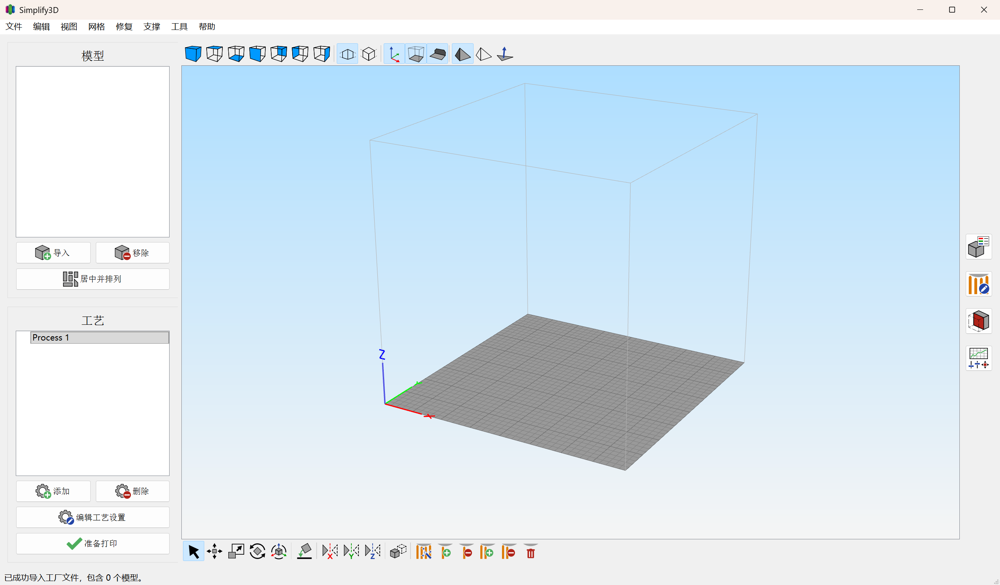

# Simplify3D 简体中文 / Simplified Chinese Language Pack

适用于已购买并安装的 Simplify3D。这是可选的简体中文启动方式，已安装的英文程序保持原样。

Optional Simplified Chinese launcher for an installed, licensed Simplify3D. The installed English program is left unchanged.



## 用法

1. 确认已安装已授权的 Simplify3D。
2. 进入 `汉化包`。
3. 双击 `Simplify3D-CN.exe`，直接打开简体中文，不再询问语言。
4. `简体中文.bat` 同样直接用中文启动。要这一次改用英文，双击 `选择语言.bat`。

启动器不需要安装 Python。只有直接运行 `launch_zh.py` 时才需要 64 位 Python。

开始菜单里的 Simplify3D，以及安装目录中的 `Simplify3D.exe`，直接打开仍然是英文。

## How to use

1. Install a licensed copy of Simplify3D.
2. Open the `汉化包` folder.
3. Double-click `Simplify3D-CN.exe` to open Simplified Chinese directly, with no language prompt.
4. `简体中文.bat` does the same. Double-click `选择语言.bat` when you want to pick English for that session.

The launcher does not need Python. 64-bit Python is only needed if you run `launch_zh.py` directly.

The Start Menu shortcut and `Simplify3D.exe` in the installation folder stay English when opened directly.

## 打包 exe

源码已经在仓库里：`汉化包/launch_zh.py`、`汉化包/zh_table.py`、`汉化包/Simplify3D-CN.spec`、`汉化包/Simplify3D.ico`。需要 64 位 Python，并安装 PyInstaller。

在 `汉化包` 目录中执行：

```powershell
python -m pip install pyinstaller
python launch_zh.py --self-test
python -m PyInstaller --noconfirm --clean Simplify3D-CN.spec
Copy-Item -Force dist\Simplify3D-CN.exe .\Simplify3D-CN.exe
```

`Simplify3D-CN.spec` 会打成无控制台窗口的单文件程序，并带上 Simplify3D 图标。生成的 `dist\Simplify3D-CN.exe` 复制回 `汉化包` 后，双击即可使用。`build` 和 `dist` 是打包中间文件，不必提交。

## Build the exe

The sources are already in the repo: `汉化包/launch_zh.py`, `汉化包/zh_table.py`, `汉化包/Simplify3D-CN.spec`, and `汉化包/Simplify3D.ico`. You need 64-bit Python and PyInstaller.

From the `汉化包` folder:

```powershell
python -m pip install pyinstaller
python launch_zh.py --self-test
python -m PyInstaller --noconfirm --clean Simplify3D-CN.spec
Copy-Item -Force dist\Simplify3D-CN.exe .\Simplify3D-CN.exe
```

`Simplify3D-CN.spec` builds a windowed, one-file executable with the Simplify3D icon. Copy `dist\Simplify3D-CN.exe` back into `汉化包` and double-click it. The `build` and `dist` folders are intermediate output and do not need to be committed.

## 说明

- 不修改安装目录里的任何文件。中文只存在于这一次启动的进程中，退出后消失。
- 主菜单、模型、工艺、支撑、工具栏和机器控制面板已收录中文。喷嘴、回抽、线宽、外墙、搭桥、熨烫等名称与 OrcaSlicer 简体中文一致。引料柱称为擦料塔，渗料防护罩称为风挡。
- 工艺里两个分组标题是「按材料自动配置」和「按质量自动配置」。配置文件里保存的名称保持原样。
- 选项中的「界面语言」仍是程序自带的 English 到 Spanish。简体中文由启动器提供，不会写成程序不认识的语言设置。
- 单位 mm、sec、mm/min，以及 Extruder 1、Fast / Medium / High、PLA / ABS / PETG 保持原文。尚未收录的句子仍显示英文。
- 杀毒软件可能提示启动脚本向程序内存写入数据。安装目录中的程序没有被改过。
- 内存钩子地址与制作本语言包时的 5.1.2 构建一致。程序代码对不上这些地址时，启动器仍会打开程序，不会因此取消启动。

## Notes

- Nothing under the installation directory is modified. Chinese exists only in that running process and is gone after you exit.
- Menus, models, processes, supports, toolbars, and the machine control panel are translated. Nozzle, retraction, line width, outer wall, bridge, ironing, and similar terms follow OrcaSlicer’s Simplified Chinese. Prime pillar is 擦料塔, and ooze shield is 风挡.
- The two process group headings read 「按材料自动配置」 and 「按质量自动配置」. Names stored in your profiles are left unchanged.
- The in-app User Language list remains the official set, from English through Spanish. Simplified Chinese comes from the launcher, so the saved language setting stays one the English program understands.
- Units (mm, sec, mm/min) and names such as Extruder 1, Fast / Medium / High, and PLA / ABS / PETG stay as written. Strings that are not in the table still appear in English.
- Antivirus software may warn that the launcher writes into the program’s memory. The installed program file is not changed.
- Memory-hook addresses match the 5.1.2 build this pack was made from. If the installed program does not match those addresses, the launcher still starts it.

## 目录

| 路径 | 内容 |
| --- | --- |
| `汉化包/Simplify3D-CN.exe` | 免 Python 启动器，双击即中文 |
| `汉化包/launch_zh.py` | 启动器源码 |
| `汉化包/zh_table.py` | 中英对照 |
| `汉化包/Simplify3D-CN.spec` | PyInstaller 打包配置 |
| `汉化包/Simplify3D.ico` | 程序图标 |
| `汉化包/简体中文.bat` | 直接以中文启动 |
| `汉化包/选择语言.bat` | 选择中文或英文 |
| `汉化包/使用说明.txt` | 简短中文说明 |
| `i18n/` | 整理界面原文时用到的脚本和列表 |

## Layout

| Path | Contents |
| --- | --- |
| `汉化包/Simplify3D-CN.exe` | Launcher that does not need Python; double-click opens Chinese |
| `汉化包/launch_zh.py` | Launcher source |
| `汉化包/zh_table.py` | English-to-Chinese table |
| `汉化包/Simplify3D-CN.spec` | PyInstaller build spec |
| `汉化包/Simplify3D.ico` | Application icon |
| `汉化包/简体中文.bat` | Start this session in Chinese |
| `汉化包/选择语言.bat` | Choose Chinese or English |
| `汉化包/使用说明.txt` | Short Chinese notes |
| `i18n/` | Scripts and source lists used while collecting interface text |
