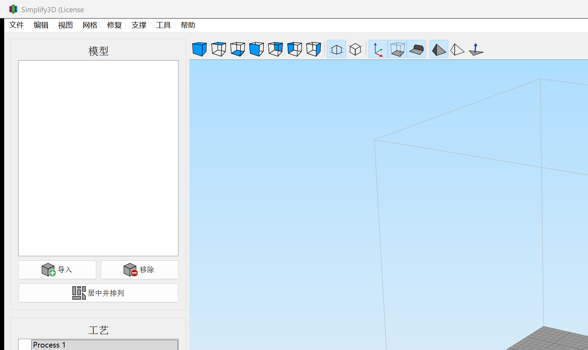

# Simplify3D 简体中文 / Simplified Chinese

适用于已购买并安装的 **Simplify3D 5.1.2**。这是额外的简体中文启动方式，不替换原来的英文。

Optional Simplified Chinese for an installed, licensed copy of **Simplify3D 5.1.2**. It does not replace the English program.

## 用法

1. 确认已安装 Simplify3D 5.1.2，并且本机有 64 位 Python。
2. 进入 `汉化包`。
3. 双击 `选择语言.bat`，再选「简体中文」或「English（默认）」。
4. 也可以双击 `简体中文.bat`，这一次直接用中文启动。

开始菜单里的 Simplify3D，以及 `C:\Program Files\Simplify3D-5.1.2\Simplify3D.exe`，直接打开仍然是英文。

## How to use

1. Install Simplify3D 5.1.2 and 64-bit Python.
2. Open the `汉化包` folder.
3. Double-click `选择语言.bat`, then choose Simplified Chinese or English (the default).
4. Or double-click `简体中文.bat` to start this session in Chinese.

The Start Menu shortcut and `Simplify3D.exe` in `C:\Program Files\Simplify3D-5.1.2` stay English when opened directly.

## 说明

- 不修改安装目录里的任何文件。中文只存在于这一次启动的进程中，退出后消失。
- 主菜单、模型、工艺、支撑、工具栏和机器控制面板已收录中文。喷嘴、回抽、线宽、外墙、搭桥、熨烫等名称与 OrcaSlicer 简体中文一致。引料柱称为擦料塔，渗料防护罩称为风挡。
- 工艺里两个分组标题是「按材料自动配置」和「按质量自动配置」。配置文件里保存的名称保持原样。
- 选项中的「界面语言」仍是程序自带的 English 到 Spanish。简体中文由启动器提供，不会写成程序不认识的语言设置。
- 单位 mm、sec、mm/min，以及 Extruder 1、Fast / Medium / High、PLA / ABS / PETG 保持原文。尚未收录的句子仍显示英文。
- 杀毒软件可能提示启动脚本向程序内存写入数据。安装目录中的程序没有被改过。
- 若安装的不是 5.1.2，启动器会提示版本不匹配并取消启动。

## Notes

- Nothing under the installation directory is modified. Chinese exists only in that running process and is gone after you exit.
- Menus, models, processes, supports, toolbars, and the machine control panel are translated. Nozzle, retraction, line width, outer wall, bridge, ironing, and similar terms follow OrcaSlicer’s Simplified Chinese. Prime pillar is 擦料塔, and ooze shield is 风挡.
- The two process group headings read 「按材料自动配置」 and 「按质量自动配置」. Names stored in your profiles are left unchanged.
- The in-app User Language list remains the official set, from English through Spanish. Simplified Chinese comes from the launcher, so the saved language setting stays one the English program understands.
- Units (mm, sec, mm/min) and names such as Extruder 1, Fast / Medium / High, and PLA / ABS / PETG stay as written. Strings that are not in the table still appear in English.
- Antivirus software may warn that the launcher writes into the program’s memory. The installed program file is not changed.
- If the installed build is not 5.1.2, the launcher reports a version mismatch and does not start it.

## 目录

| 路径 | 内容 |
| --- | --- |
| `汉化包/简体中文.bat` | 直接以中文启动 |
| `汉化包/选择语言.bat` | 选择中文或英文 |
| `汉化包/zh_table.py` | 中英对照 |
| `汉化包/使用说明.txt` | 简短中文说明 |
| `i18n/` | 整理界面原文时用到的脚本和列表 |

## Layout

| Path | Contents |
| --- | --- |
| `汉化包/简体中文.bat` | Start this session in Chinese |
| `汉化包/选择语言.bat` | Choose Chinese or English |
| `汉化包/zh_table.py` | English-to-Chinese table |
| `汉化包/使用说明.txt` | Short Chinese notes |
| `i18n/` | Scripts and source lists used while collecting interface text |
